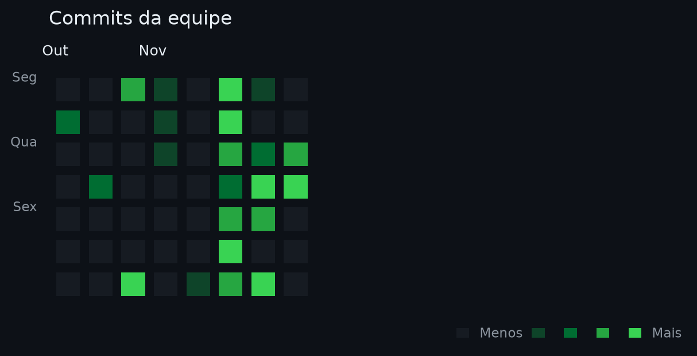
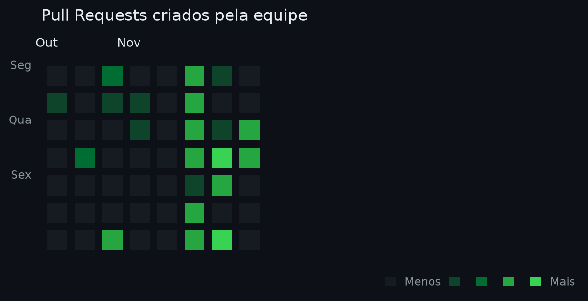
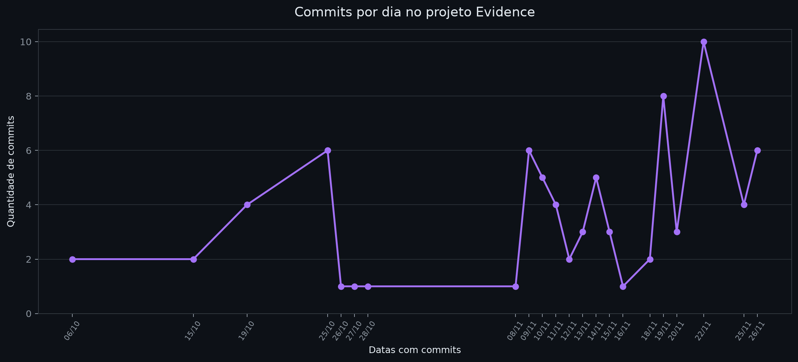

# Evidence

Sistema web para registrar e acompanhar atividades em uma linha do tempo. Os registros podem ser organizados com tags e filtros, em ambientes pessoais ou de empresas.

## Equipe

- Caio Oliveira Botelho — [@caiobotelho1](https://github.com/caiobotelho1)
- Isabela Kawashima — [@isabelakawashima ](https://github.com/isabelakawashima)
- Izabela Sanitá — [@izabelasanita](https://github.com/izabelasanita)
- Maria Eduarda Mendes — [@mendeseduarda](https://github.com/mendeseduarda)

## Sumário

- [Funcionalidades](#funcionalidades)
- [Tecnologias](#tecnologias)
- [Como a equipe trabalhou](#como-a-equipe-trabalhou)
- [Padrão de projeto: Strategy](#padrão-de-projeto-strategy)
- [Como executar localmente](#como-executar-localmente)
- [Testes](#testes)
- [Escopo da avaliação](#escopo-da-avaliação)
- [Documentação complementar](#documentação-complementar)

## Funcionalidades

O sistema reúne funcionalidades para:

- Criar uma conta, autenticar-se e gerenciar dados do perfil.
- Cadastrar empresas e solicitar participação em uma empresa.
- Aprovar ou recusar solicitações de participação e gerenciar membros.
- Criar registros pessoais ou associados a uma empresa.
- Organizar registros com tags, status, datas e responsáveis.
- Consultar registros em uma linha do tempo e aplicar filtros.
- Anexar arquivos aos registros.

## Tecnologias

- **Frontend:** Next.js, React e TypeScript.
- **Backend:** Node.js, Express e TypeScript.
- **Persistência:** PostgreSQL e Prisma.
- **Testes:** Node.js Test Runner e Playwright.
- **Ambiente de banco de dados:** Docker Compose.

## Como a equipe trabalhou

O desenvolvimento foi iterativo e incremental. A equipe começou criando quatro telas no Figma e, em seguida, foi implementando e refinando as funcionalidades em etapas.

O trabalho foi acompanhado pelo GitHub. As histórias de usuário, tarefas e alterações podem ser consultadas nas Issues e nos Pull Requests do repositório.

O gráfico abaixo resume a frequência de commits e Pull Requests abertos ao longo do projeto:





> **Observação:** Os gráficos foram gerados com base nos dados disponíveis na API do GitHub no momento da consulta. Como esses dados podem ser atualizados, os quantitativos podem apresentar pequenas variações em novas execuções. Ainda assim, a distribuição das contribuições representa o fluxo de trabalho registrado ao longo do projeto.

Veja [como o gráfico é calculado](docs/processo-de-desenvolvimento.md).

## Padrão de projeto: Strategy

O padrão **Strategy** foi aplicado à montagem dos filtros dos registros. Cada estratégia sabe identificar se um filtro está ativo e construir a condição correspondente para a consulta ao banco.

As estratégias implementadas cobrem tags, status, período e funcionários. O serviço pode combinar as condições ativas sem concentrar todas as regras de filtro em uma única estrutura condicional.

A implementação está em:

- `backend/src/services/activity-record.filter-strategy.ts`
- `backend/src/services/activity-record.filter-strategy.test.ts`

A busca por texto é construída separadamente e pode ser combinada com os filtros. Os testes verificam a composição das condições e a preservação do escopo de acesso do funcionário.

## Como executar localmente

### Pré-requisitos

- Node.js e npm.
- Docker com Docker Compose.
- PostgreSQL é iniciado pelo Docker Compose configurado no backend.

### 1. Configurar as variáveis de ambiente

Na raiz do projeto:

```bash
cp backend/.env.example backend/.env
cp frontend/.env.example frontend/.env.local
```

Confira os valores em `backend/.env` e `frontend/.env.local` antes de iniciar os serviços.

### 2. Iniciar o banco de dados

```bash
cd backend
docker compose up -d
```

O PostgreSQL é disponibilizado na porta `5434`, conforme a configuração do Compose.

### 3. Instalar dependências, gerar o Prisma Client e aplicar migrations

Ainda na pasta `backend`:

```bash
npm ci
npx prisma generate --config prisma7.config.ts
npx prisma migrate deploy --config prisma7.config.ts
```

### 4. Iniciar o backend

Na pasta `backend`:

```bash
npm run dev
```

A API usa a porta definida em `backend/.env`, configurada por padrão como `3333`.

### 5. Iniciar o frontend

Em outro terminal, na raiz do projeto:

```bash
cd frontend
npm ci
npm run dev
```

Acesse [http://localhost:3000](http://localhost:3000).

### Encerrar o banco

Na pasta `backend`:

```bash
docker compose down
```

O Compose do backend mantém os dados em um volume. Para remover esse volume e os dados locais, use `docker compose down -v`.

## Testes

### Testes de unidade do backend

```bash
cd backend
npm test
```

### Testes E2E

Os testes E2E usam Playwright, Chromium e um PostgreSQL separado. Consulte [`e2e/README.md`](e2e/README.md) para os pré-requisitos e comandos completos.

Os cenários atuais cobrem a solicitação de participação em uma empresa e a aprovação ou recusa dessa solicitação.

## Escopo da avaliação

A tabela de requisitos, evidências e itens que ainda precisam de conferência está em [`docs/avaliacao.md`](docs/avaliacao.md).

## Documentação complementar

- [Processo de desenvolvimento e gráfico de contribuições](docs/processo-de-desenvolvimento.md)
- [Requisitos da avaliação e evidências](docs/avaliacao.md)
- [Instruções dos testes E2E](e2e/README.md)