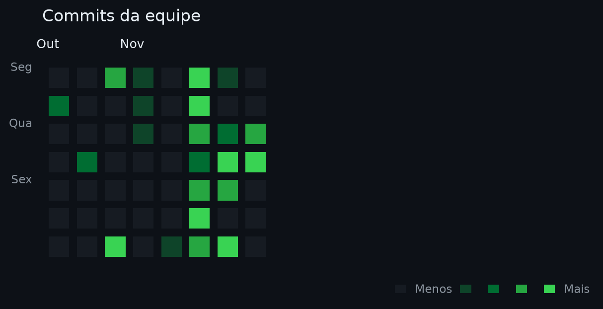
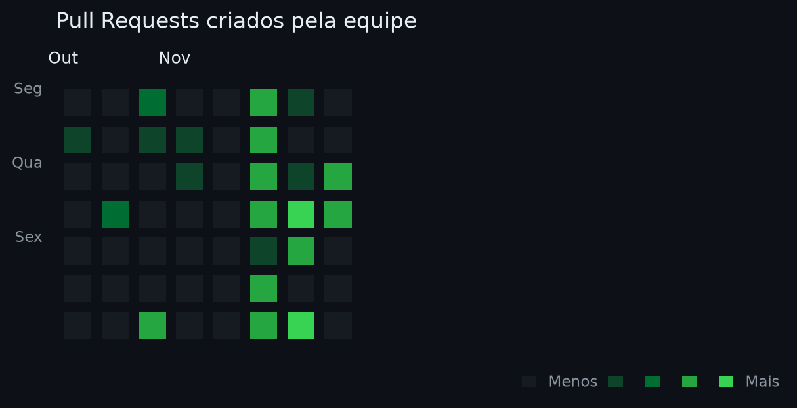
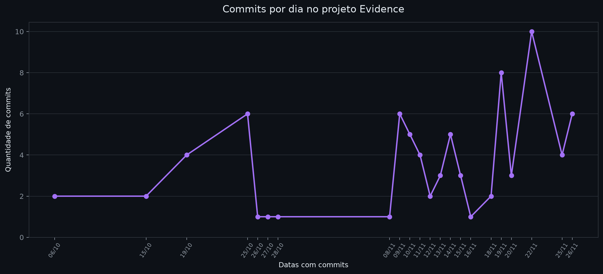

# Processo de desenvolvimento

Trabalhamos no Evidence de forma incremental. Organizamos a implementação das histórias de usuário em três frentes: frontend, backend e integração entre os dois.

Ao longo do desenvolvimento, conectamos as telas às rotas e aos serviços do backend. Depois da integração, trabalhamos em ajustes e correções para refinar o funcionamento do sistema.

Usamos Issues e Pull Requests para acompanhar as histórias e registrar as alterações realizadas. O histórico de contribuições abaixo resume a atividade registrada no GitHub durante o projeto.

> **Observação:** Os gráficos foram gerados com base nos dados disponíveis na API do GitHub no momento da consulta. Os quantitativos podem variar em novas execuções caso esses dados sejam atualizados. A distribuição apresentada representa o fluxo de trabalho registrado ao longo do projeto.